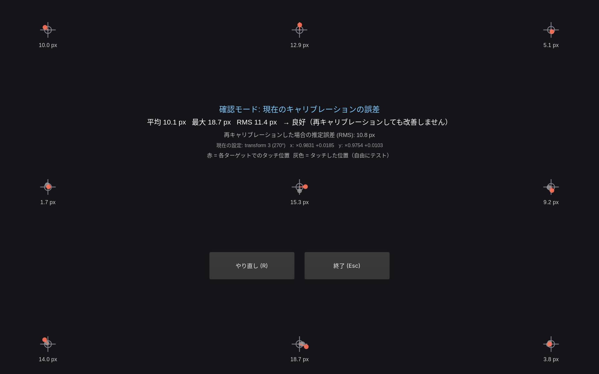

# gpd-touch-calibrator

English | [日本語](README_ja.md)

Touchscreen calibration tool for the GPD Pocket 3 running Omarchy / Hyprland.

It shows fullscreen targets, records where your touches actually land, fits a correction and
installs it in two parts:

- Rotation / flip: Hyprland's `input:touchdevice:transform` (`~/.config/hypr/touch_calibration.lua`)
- Scale / offset: the kernel's absolute axis ranges, overridden with udev `EVDEV_ABS_xx`

Since Hyprland 0.55, Hyprland overwrites the libinput calibration matrix with the identity
matrix even when `transform` isn't set, so a udev `LIBINPUT_CALIBRATION_MATRIX` has no effect
([hyprwm/Hyprland#16692](https://github.com/hyprwm/Hyprland/discussions/16692)).
The tool therefore leaves rotation to Hyprland and does the fine correction below libinput
(the axis ranges). A slight skew (shear) cannot be corrected.



## Usage

```bash
./install.sh                    # install to /usr/local/bin and add a launcher entry
gpd-touch-calibrator            # 5-point calibration
gpd-touch-calibrator --points 9
gpd-touch-calibrator --dry-run  # print the settings without installing them
gpd-touch-calibrator --show     # show the detected device and current settings
gpd-touch-calibrator --check    # touch the targets to measure the current error (changes nothing)
gpd-touch-calibrator --reset    # remove the calibration
gpd-touch-calibrator --lang ja  # UI language (en / ja)
```

1. Touch the center of the red cross and lift (Backspace goes back one)
2. On the test screen, touches show gray = current position, green = corrected position
3. "Apply" (Enter) writes the udev rule via pkexec, rebinds the HID driver, sets Hyprland's
   transform and takes effect immediately

`--check` uses the same targets and shows the error of each point (px), the mean / max / RMS
error and the estimated error after recalibrating (also printed to stdout). There is no Apply
button. The verdict is based on how much a recalibration would gain, not on the absolute error
("Good" when the gain is under 2 px and under 25% of the current RMS): finger touches scatter by
a few millimeters, which no correction can remove.

A touch that the other touches' fit misses by more than 40 px (and 3× that fit's own error) is
treated as a slip: its target is circled in yellow and you are asked to retry. Use `--points 9`
for this; with 5 points only about half of the slips can be told apart.

The UI language is set with `--lang`. Without it, Japanese is used when `LC_ALL` /
`LC_MESSAGES` / `LANG` starts with `ja`, English otherwise.

## How it works

- Rule: `/etc/udev/rules.d/99-gpd-touch-calibration.rules` (the original axis ranges and the
  scale are stored as JSON in its header)
- Hyprland: creates `~/.config/hypr/touch_calibration.lua` and appends
  `require("hypr.touch_calibration")` to `hyprland.lua` (once, backed up as `hyprland.lua.bak.*`)
- Target: `ID_INPUT_TOUCHSCREEN=1` with a matching device name (`GXTP7380:00 27C6:0113`).
  The stylus is not affected
- Re-runs compose with the installed transform and axis ranges, so you can refine it as often
  as you like
- `--reset` removes the rule, the Lua module and the `require` line
